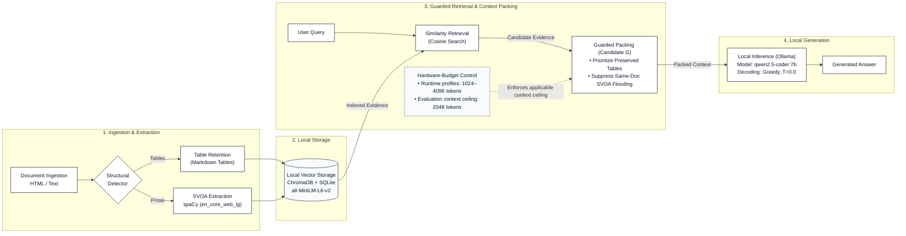

# Précis System Architecture & Pipeline Data Flow

**Document**: `docs/architecture.md`  
**Date**: October 11, 2026  
**Implementation Authority**: `backend/src/precis/`  
**Status**: Authoritative Architectural Specification & Pipeline Map  

---

## 1. System Overview

**Précis** is an edge-oriented, offline-capable Retrieval-Augmented Generation (RAG) system engineered to execute locally without mandatory cloud API egress. The system addresses structural information loss and prompt bloat in edge question answering by combining:
1. **Preserved Structural Parsing**: Direct extraction and rendering of tables from input documents into intact Markdown formats.
2. **Propositional Information Extraction**: Dependency-parsed Subject-Verb-Object-Adjunct (SVOA) propositions annotated with negation and epistemic modality using spaCy (`en_core_web_lg`).
3. **Guarded Structural-Priority Context Packing (Candidate G)**: Prioritizing preserved structural tables, gating cross-document propositions, and strictly capping same-document distractor propositions.
4. **Hardware-Calibrated Offline Inference**: Hardware sensing and dynamic token budgeting dispatching queries to a locally hosted Ollama instance (`qwen2.5-coder:7b` across reported benchmark evaluations; `qwen3.5:4b` configured as default in hardware runtime profiling).

---

## 2. Publication Architecture Diagram

> **Publication Layout & Evidence Flow Note**:  
> The diagram flows left-to-right across four functional stages. The evidence flow matches the verified pipeline: local storage supplies indexed representations to similarity retrieval, similarity retrieval provides candidate evidence to guarded packing, hardware-budget control directly constrains the packing ceiling via a dashed control connector, and guarded packing passes the assembled context to local inference.

---

## 3. Core Implementation & Budget Nuances

### 3.1 Hardware-Budget Control vs. Evaluation Context Ceiling
The diagram and codebase distinguish between runtime operational profiles and the experimental evaluation budget:
- **Runtime Hardware Profiles (`hardware.py`)**: Senses available physical host RAM, VRAM, and GPU acceleration to dynamically calibrate operating mode context ceilings:
  - `gpu`: 4,096 tokens
  - `gpu-partial`: 3,072 tokens
  - `cpu`: 2,048 tokens
  - `cpu-light`: 1,024 tokens
- **Evaluation Context Ceiling (`2048 tokens`)**: In the reported confirmatory benchmark of Candidate G (`eval_experiment_4_8_0_confirmatory.py`), the packing engine was evaluated under a fixed ceiling of **2,048 tokens** (`DEFAULT_TOKEN_CEILING = 2048`).
- **Profile Boundary**: Candidate G observed a maximum of 1,163 tokens (0 ceiling violations against 2,048 tokens). However, under the 1,024-token budget allocated to the constrained `cpu-light` profile, 7 of the 200 evaluated cases exceed budget and require truncation. Compliance with the 2,048-token evaluation context ceiling does not establish un-truncated execution across all runtime profiles.

### 3.2 Candidate G Guarded Packing Mechanisms
Implemented in `backend/src/precis/pipeline/structural.py` (`assemble_structural_query_context`):
1. **Preserved Table Prioritization**: Retained Markdown tables with query relevance are placed first into the available context window.
2. **Same-Document SVOA Suppression**: When a table from document $D$ is placed into the prompt, all SVOA propositions originating from document $D$ are actively suppressed to prevent distractor flooding, redundant noise, and preamble generation.
3. **Cross-Document Proposition Packing**: Relevant propositions from other documents in the local store are greedily packed into the remaining token headroom up to the specified ceiling.

---

## 4. Component Verification & Traceability Matrix

Every node, module, and data boundary in the architecture is verified against physical source code in `backend/src/precis/`:

| Component / Subsystem | Primary Source File | Implementation Status | Verified Behavior & Nuances |
| :--- | :--- | :---: | :--- |
| **Document Ingestion** | `backend/src/precis/pipeline/orchestrator.py` | **Implemented** | Entry point `ingest_document()` receives raw document text (HTML or plain text) and dispatches structural and prose parsers. |
| **Structural Detector & Table Retention** | `backend/src/precis/pipeline/structural.py` | **Implemented** | Detects HTML tables via `StructuralDocumentParser` (HTMLParser subclass) and formats them as intact GitHub Flavored Markdown blocks (`score_and_select_tables`, `render_gfm_table_chunks`). |
| **SVOA Extraction** | `backend/src/precis/pipeline/svoa.py` | **Implemented** | Dependency parsing via spaCy (`en_core_web_lg`) extracts Subject-Verb-Object-Adjunct propositions; tags negation (`bool`) and epistemic modality (`asserted`, `attributed`, `conditional`, `hypothetical`). |
| **Local Vector Storage** | `backend/src/precis/graph/store.py` | **Implemented** | Embeds representations via `all-MiniLM-L6-v2`; persists vector collections in ChromaDB and structured metadata in SQLite/in-memory schema. |
| **Similarity Retrieval** | `backend/src/precis/pipeline/packer.py` | **Implemented** | Uses `store.query_similar()` and `store.query_similar_structural()` to retrieve top-$k$ candidate propositions and structural blocks via cosine similarity with the query embedding. |
| **Hardware-Budget Control** | `backend/src/precis/pipeline/hardware.py` | **Implemented** | Inspects RAM and VRAM; sets runtime profile ceilings (1,024–4,096 tokens). The reported confirmatory evaluation enforced an evaluation-specific 2,048-token ceiling. |
| **Guarded Packing (Candidate G)** | `backend/src/precis/pipeline/structural.py` | **Implemented** | Function `assemble_structural_query_context()` enforces table priority, suppresses same-document propositions, and caps packing at the specified token ceiling. |
| **Local LLM Inference** | `backend/src/precis/pipeline/inference.py` | **Implemented** | Dispatches prompts to local Ollama HTTP endpoint (`http://localhost:11434`) using deterministic greedy decoding ($T=0.0$). The reported confirmatory evaluation used `qwen2.5-coder:7b`; the runtime profiler in `hardware.py` defaults to `qwen3.5:4b`. |
| **Generated Answer** | `backend/src/precis/pipeline/orchestrator.py` | **Implemented** | Returns generated string response to caller without external cloud network calls in nominal deployment. |
