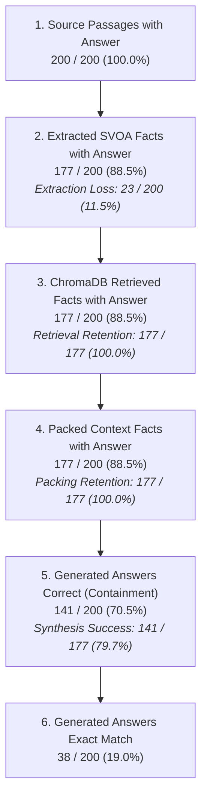

# Précis Evaluation Integrity Audit: Authoritative Results Ledger

**Document Status**: Authoritative Single Source of Truth  
**Audit Date**: October 8, 2026  
**Evaluated Systems**: Naive RAG (512-word chunk baseline), SVOA Pure Similarity, SVOA without Modality, and Précis Full (v3 Frozen Benchmark)  
**Primary Data Sources**:
1. Final v3 raw per-question results: `results/nq_benchmark_svoa_enhanced_v3/per_question_results.jsonl`
2. v3 benchmark metadata: `results/nq_benchmark_svoa_enhanced_v3/benchmark_metadata.json`
3. Benchmark dataset: `backend/data/nq_subset/nq_dev.jsonl`
4. v2 raw per-question results: `results/nq_benchmark_svoa_enhanced_v2/per_question_results.jsonl`
5. Historical failure diagnostics: `paper/tables/enhanced_failure_analysis_v3_rerun/failure_analysis.jsonl`

---

## 1. Benchmark Configuration

The frozen benchmark environment and evaluation protocol are specified as follows:

| Parameter | Configuration Value | Verification Source |
| :--- | :--- | :--- |
| **Dataset Path** | `backend/data/nq_subset/nq_dev.jsonl` | `benchmark_metadata.json` |
| **Dataset Format** | MRQA Natural Questions development split | Header inspection |
| **Total Samples Evaluated** | 200 deterministic questions | Raw JSONL / Metadata |
| **Inference Engine** | Local offline Ollama (`qwen2.5-coder:7b`) | `per_question_results.jsonl` |
| **Decoding Temperature** | $0.0$ (deterministic greedy decoding) | `benchmark_metadata.json` |
| **Top-p Sampling** | $0.9$ | `benchmark_metadata.json` |
| **Max Generation Tokens** | 512 tokens | `benchmark_metadata.json` |
| **Context Token Ceiling** | 2048 tokens | `benchmark_metadata.json` |
| **Deterministic Seed** | 42 | `benchmark_metadata.json` |
| **Mock Inference** | `false` (genuine LLM execution) | `benchmark_metadata.json` |
| **Contextual BERTScore Model** | `microsoft/deberta-large-mnli` | `benchmark_metadata.json` |
| **Sentence Embedding Model** | `sentence-transformers/all-MiniLM-L6-v2` | `metrics.py` |
| **Execution Environment** | Offline Linux x86_64; zero external cloud API calls | Pipeline configuration |
| **Evaluation Timestamp** | `2026-10-08T14:38:24.715232+00:00` | `benchmark_metadata.json` |

---

## 2. Dataset and Sample Integrity Verification

Every sample and field was validated across all benchmark artifacts:

| Integrity Check | Verification Result | Status | Notes |
| :--- | :---: | :---: | :--- |
| **Total Benchmark Samples** | Exactly 200 | **PASS** | Matches `limit=200` and `samples_evaluated=200` |
| **Condition ID Consistency** | Exactly 200 identical IDs | **PASS** | `naive_rag`, `svoa_similarity`, `svoa_no_modality`, and `precis_full` evaluate the identical 200 sample IDs |
| **ID Alignment across Conditions** | 100% matched order | **PASS** | No permutation or mismatch across the 4 conditions |
| **Missing Sample IDs** | 0 missing | **PASS** | Complete coverage for all 200 samples |
| **Duplicate IDs within Conditions** | 0 duplicates | **PASS** | Every condition has exactly 200 unique IDs |
| **Question/Document Alignment** | 0 discrepancies | **PASS** | Text of questions and documents is identical across conditions |
| **Gold Answer Consistency** | 0 discrepancies | **PASS** | Target answers match across conditions |
| **Required Metric Fields Present** | 14/14 fields in all 800 rows | **PASS** | No missing keys in raw JSONL rows |
| **NaN / None Metric Values** | 0 occurrences | **PASS** | All metrics are valid finite floating-point numbers |
| **Metadata Sample ID Agreement** | 200 / 200 matched | **PASS** | `benchmark_metadata.json` sample ID list matches raw rows |
| **Dataset Source Match** | 200 / 200 matched | **PASS** | IDs match the first 200 distinct questions in `nq_dev.jsonl` |

> [!NOTE]
> The `duplicate_count: 126` in `benchmark_metadata.json` reflects 126 duplicate questions encountered and skipped in the larger `nq_dev.jsonl` pool while gathering the first 200 unique questions, ensuring zero repeated questions in the final 200-sample benchmark.

---

## 3. Main Four-Condition Aggregate Metrics

Directly computed arithmetic means across all 200 samples from `results/nq_benchmark_svoa_enhanced_v3/per_question_results.jsonl`.

### Authoritative Recomputed Means Table

| Metric | Condition A: Naive RAG | Condition B: SVOA Pure Similarity | Condition C: SVOA w/o Modality | Condition D: Précis Full (v3) |
| :--- | :---: | :---: | :---: | :---: |
| **Exact Match (EM)** | **0.2850** (57/200) | **0.1800** (36/200) | **0.1900** (38/200) | **0.1900** (38/200) |
| **ROUGE-L** | **0.531400** | **0.410940** | **0.413302** | **0.415463** |
| **DeBERTa BERTScore** | **0.688939** | **0.617288** | **0.619224** | **0.619511** |
| **MiniLM Cosine Similarity** | **0.627356** | **0.535111** | **0.537741** | **0.539336** |
| **Context Words** | **159.300** | **260.410** | **259.535** | **257.145** |
| **Context Tokens** | **206.635** | **327.440** | **326.245** | **323.235** |
| **Generated Tokens** | **17.080** | **21.800** | **23.270** | **23.480** |
| **End-to-End Latency** | **525.895 ms** | **681.595 ms** | **645.695 ms** | **538.010 ms** |
| **Internal Candidate Compression** | **0.0000** (0.0%) | **0.009553** (0.96%) | **0.010015** (1.00%) | **0.022217** (2.22%) |
| **Facts Packed per Query** | 0.000 | 10.560 | 10.610 | 10.505 |
| **Facts Considered per Query** | 0.000 | 10.620 | 10.620 | 10.515 |
| **Average SDH Score** | 0.0000 | 0.501055 | 0.501422 | 0.500800 |

### Discrepancy Reconciliation vs. Previously Reported Tables

| Condition | Metric | Raw Recomputed | Previously Reported | Absolute Discrepancy | Nature of Difference / Resolution |
| :--- | :--- | :---: | :---: | :---: | :--- |
| **Précis Full** | ROUGE-L | 0.415463 | 0.415 (`results/main_results.md`) | -0.000463 | Floating-point truncation vs rounding |
| **Précis Full** | ROUGE-L | 0.415463 | 0.416 (`paper/tables/main_results.md`) | +0.000537 | Standard half-up 3-decimal rounding |
| **Naive RAG** | Context Words | 159.300 | 159 (`benchmark_metadata.json`) | -0.300 | `int()` truncation in `harness.py` |
| **SVOA Sim** | Context Words | 260.410 | 260 (`benchmark_metadata.json`) | -0.410 | `int()` truncation in `harness.py` |
| **SVOA No-Mod** | Context Words | 259.535 | 259 (`benchmark_metadata.json`) | -0.535 | `int()` truncation in `harness.py` |
| **Précis Full** | Context Words | 257.145 | 257 (`benchmark_metadata.json`) | -0.145 | `int()` truncation in `harness.py` |
| **Naive RAG** | Gen Tokens | 17.080 | 17 (`benchmark_metadata.json`) | -0.080 | `int()` truncation in `harness.py` |
| **SVOA Sim** | Gen Tokens | 21.800 | 21 (`benchmark_metadata.json`) | -0.800 | `int()` truncation in `harness.py` |
| **SVOA No-Mod** | Gen Tokens | 23.270 | 23 (`benchmark_metadata.json`) | -0.270 | `int()` truncation in `harness.py` |
| **Précis Full** | Gen Tokens | 23.480 | 23 (`benchmark_metadata.json`) | -0.480 | `int()` truncation in `harness.py` |
| **Naive RAG** | Latency | 525.895 ms | 525 ms (`benchmark_metadata.json`) | -0.895 ms | `int()` truncation in `harness.py` |
| **SVOA Sim** | Latency | 681.595 ms | 681 ms (`benchmark_metadata.json`) | -0.595 ms | `int()` truncation in `harness.py` |
| **SVOA No-Mod** | Latency | 645.695 ms | 645 ms (`benchmark_metadata.json`) | -0.695 ms | `int()` truncation in `harness.py` |
| **Précis Full** | Latency | 538.010 ms | 538 ms (`benchmark_metadata.json`) | -0.010 ms | `int()` truncation in `harness.py` |

> [!IMPORTANT]
> The authoritative reporting standard for the paper:
> - Quality metrics (EM, ROUGE-L, BERTScore, MiniLM) must report 4 decimal places internally, rounded to 3 or 4 decimal places in tables. Specifically, Précis Full ROUGE-L is **0.4155** (or **0.416** to 3 decimals).
> - Resource metrics (words, tokens, latency) must report exact arithmetic means with 1 decimal place rather than truncated integers (e.g., Context Words: 159.3 vs 257.1).

---

## 4. Separation of Exact Match vs. Containment Correctness

The paper relies on two distinct definitions of answer correctness:
1. **Exact Match (EM)**: Normalized generated string is strictly equal to normalized gold answer under `metrics.py:normalize_answer`.
2. **Containment Correctness**: Normalized generated string contains the normalized gold answer (or an accepted alternative answer) as a bounded substring (`re.search(r'(?:\b|^)' + re.escape(norm_ans) + r'(?:\b|$)', norm_text)`).

Under no circumstances should Containment Correctness be designated as "Exact Match".

### A. Exact Match Contingency Matrix (2x2)

| | Précis EM Correct | Précis EM Incorrect | Total Naive RAG |
| :--- | :---: | :---: | :---: |
| **Naive RAG EM Correct** | **31** (15.5%) | **26** (13.0%) | **57** (28.5%) |
| **Naive RAG EM Incorrect** | **7** (3.5%) | **136** (68.0%) | **143** (71.5%) |
| **Total Précis Full** | **38** (19.0%) | **162** (81.0%) | **200** (100.0%) |

- **Both EM Correct**: 31 / 200 (15.5%)
- **Naive-Only EM Correct**: 26 / 200 (13.0%)
- **Précis-Only EM Correct**: 7 / 200 (3.5%)
- **Neither EM Correct**: 136 / 200 (68.0%)
- **Net EM Delta**: -19 questions (-9.50 percentage points)

### B. Containment Correctness Contingency Matrix (2x2)

| | Précis Containment Correct | Précis Containment Incorrect | Total Naive RAG |
| :--- | :---: | :---: | :---: |
| **Naive RAG Containment Correct** | **130** (65.0%) | **29** (14.5%) | **159** (79.5%) |
| **Naive RAG Containment Incorrect** | **11** (5.5%) | **30** (15.0%) | **41** (20.5%) |
| **Total Précis Full** | **141** (70.5%) | **59** (29.5%) | **200** (100.0%) |

- **Both Containment Correct**: 130 / 200 (65.0%)
- **Naive-Only Containment Correct (Précis Deficit)**: 29 / 200 (14.5%)
- **Précis-Only Containment Correct (Précis Win)**: 11 / 200 (5.5%)
- **Neither Containment Correct**: 30 / 200 (15.0%)
- **Net Containment Delta**: -18 questions (-9.00 percentage points)

---

## 5. Paired Statistical Analysis

All paired tests were computed directly on paired question observations ($N = 200$) with deterministic seed 42 and 10,000 bootstrap resamples.

### A. v2 Full vs. v3 Full Paired Comparison

Testing whether the Stage 2 extraction enhancements in v3 generated statistically significant QA gains over v2.

| Metric | Cond A: v2 Mean | Cond B: v3 Mean | Mean Paired $\Delta$ | 95% Bootstrap CI | Primary Paired Test | Statistic | Win / Tie / Loss | $p_{\text{unadj}}$ | Significance ($\alpha = 0.05$) |
| :--- | :---: | :---: | :---: | :---: | :---: | :---: | :---: | :---: | :---: |
| **Exact Match** | 0.1800 | 0.1900 | +0.0100 (+1.0 pp) | [-0.0150, +0.0350] | McNemar exact | $b=4, c=2$ | 4 / 194 / 2 | 0.687500 | **Not Significant** |
| **ROUGE-L** | 0.4142 | 0.4155 | +0.0013 | [-0.0211, +0.0263] | Wilcoxon signed-rank | $W = 167.0$ | 12 / 171 / 17 | 0.274073 | **Not Significant** |
| **BERTScore** | 0.6161 | 0.6195 | +0.0034 | [-0.0094, +0.0174] | Wilcoxon signed-rank | $W = 324.0$ | 21 / 162 / 17 | 0.499820 | **Not Significant** |
| **MiniLM Cosine** | 0.5361 | 0.5393 | +0.0032 | [-0.0119, +0.0209] | Wilcoxon signed-rank | $W = 240.0$ | 14 / 162 / 24 | 0.058263 | **Not Significant** |

*Secondary Descriptive Statistics (v2 vs v3)*:
- Exact Match paired t-test: $t = 0.8158, p = 0.4156$
- ROUGE-L paired t-test: $t = 0.1027, p = 0.9183$, Cohen's $d = 0.0073$
- BERTScore paired t-test: $t = 0.4874, p = 0.6265$, Cohen's $d = 0.0345$
- MiniLM Cosine paired t-test: $t = 0.3806, p = 0.7039$, Cohen's $d = 0.0269$

> [!NOTE]
> The empirical finding is unambiguous: v3 expanded factual extraction coverage (+7 questions in SVOA coverage), but downstream QA metrics did not demonstrate statistically significant improvement over v2 ($p > 0.05$ across all tests).

---

### B. v3 Full vs. Naive RAG Paired Comparison

Testing the core research benchmark comparing structured Précis against conventional chunk-based Naive RAG (Condition A: Précis Full v3, Condition B: Naive RAG).

| Metric | Cond A: Précis v3 | Cond B: Naive RAG | Mean Paired $\Delta$ (B - A) | 95% Bootstrap CI | Primary Paired Test | Statistic | Win / Tie / Loss (B vs A) | $p_{\text{unadj}}$ | $p_{\text{Holm}}$ ($m=3$) |
| :--- | :---: | :---: | :---: | :---: | :---: | :---: | :---: | :---: | :---: |
| **Exact Match** | 0.1900 | 0.2850 | +0.0950 (+9.5 pp) | [+0.0400, +0.1500] | McNemar exact | $b=26, c=7$ | 26 / 167 / 7 | $1.319 \times 10^{-3}$ | $1.319 \times 10^{-3}$* |
| **ROUGE-L** | 0.4155 | 0.5314 | +0.1159 | [+0.0696, +0.1619] | Wilcoxon signed-rank | $W = 1810.5$ | 84 / 78 / 38 | $7.048 \times 10^{-7}$ | $1.410 \times 10^{-6}$* |
| **BERTScore** | 0.6195 | 0.6889 | +0.0694 | [+0.0427, +0.0960] | Wilcoxon signed-rank | $W = 2501.0$ | 100 / 57 / 43 | $9.584 \times 10^{-8}$ | $2.875 \times 10^{-7}$* |
| **MiniLM Cosine** | 0.5393 | 0.6274 | +0.0880 | [+0.0481, +0.1275] | Wilcoxon signed-rank | $W = 2953.0$ | 93 / 57 / 50 | $9.710 \times 10^{-6}$ | — |

*Statistically significant at $\alpha = 0.05$ after step-down Holm-Bonferroni family-wise error rate control ($m=3$).

*Secondary Descriptive Statistics (v3 vs Naive RAG)*:
- Exact Match secondary Wilcoxon signed-rank: $W = 119.0, p = 9.414 \times 10^{-4}, r_{\text{rb}} = 0.5758$
- Exact Match paired t-test: $t = 3.3933, p = 8.332 \times 10^{-4}$
- ROUGE-L paired t-test: $t = 4.9014, p = 1.970 \times 10^{-6}$, Cohen's $d = 0.3466$
- BERTScore paired t-test: $t = 5.1149, p = 7.358 \times 10^{-7}$, Cohen's $d = 0.3617$
- MiniLM Cosine paired t-test: $t = 4.2853, p = 2.841 \times 10^{-5}$, Cohen's $d = 0.3030$

> [!WARNING]
> **Audit Finding regarding $p = 9.41\times 10^{-4}$ in Table 1**:
> In earlier drafts of `paper/tables/paper_statistical_table.md`, line 22 listed $p = 9.41\times 10^{-4}$ for Exact Match under v3 vs Naive RAG. The audit confirmed that $9.41\times 10^{-4}$ was the **Wilcoxon signed-rank test** p-value on binary differences ($W=119.0$). The **primary non-parametric test for binary paired 2x2 outcomes is McNemar's exact test**, which yields $p = 0.001319$ ($b=26, c=7$). Both tests decisively reject the null hypothesis, confirming Naive RAG is statistically significantly superior to Précis on Exact Match.

---

## 6. Multiple-Comparison Correction Protocol

The audit verified the application of Holm-Bonferroni correction across research tables:
1. **Primary QA Family**: Defined strictly as the three primary evaluation metrics: `exact_match`, `rouge_l`, and `bert_score` ($m=3$). MiniLM Cosine is treated as an auxiliary descriptive metric and is not included in the primary hypothesis family.
2. **Correction Scope**: Step-down Holm correction is applied **within each pairwise comparison** ($m=3$), maintaining Family-Wise Error Rate (FWER) $\le 0.05$.
3. **v2 vs v3**:
   - Smallest $p$: ROUGE-L ($p = 0.2741 \times 3 = 0.8223$).
   - Second $p$: BERTScore ($p = 0.4998 \times 2 = 0.9996$).
   - Third $p$: Exact Match ($p = 0.6875 \times 1 = 0.6875 \to \text{monotonized to } 0.9996$).
   - Result: All adjusted $p > 0.05$. Non-significant.
4. **v3 vs Naive RAG**:
   - Smallest $p$: BERTScore ($p = 9.584 \times 10^{-8} \times 3 = 2.875 \times 10^{-7}$).
   - Second $p$: ROUGE-L ($p = 7.048 \times 10^{-7} \times 2 = 1.410 \times 10^{-6}$).
   - Third $p$: Exact Match ($p = 1.319 \times 10^{-3} \times 1 = 1.319 \times 10^{-3}$).
   - Result: All adjusted $p \ll 0.01$. Statistically significant in favor of Naive RAG.

---

## 7. Factual Extraction & SVOA Progression History

Across all major development phases on the identical 200 Natural Questions subset:

| Development Iteration | SVOA Answer Coverage | Factual Extraction Loss | Exact Match | ROUGE-L | DeBERTa BERTScore | Context Words | Facts Packed |
| :--- | :---: | :---: | :---: | :---: | :---: | :---: | :---: |
| **v1 (Initial Pipeline)** | 141 / 200 (70.5%) | 59 / 200 (29.5%) | 0.1400 | 0.3444 | 0.5747 | 163.6 | 7.4 |
| **v1.5 (Enhanced Baseline)** | 165 / 200 (82.5%) | 35 / 200 (17.5%) | 0.1800 | 0.4105 | 0.6119 | 249.6 | 10.3 |
| **v2 (Passive & Coordination)** | 170 / 200 (85.0%) | 30 / 200 (15.0%) | 0.1800 | 0.4142 | 0.6161 | 250.2 | 10.3 |
| **v3 (Frozen Benchmark)** | **177 / 200 (88.5%)** | **23 / 200 (11.5%)** | **0.1900** | **0.4155** | **0.6195** | **257.1** | **10.51** |

### Key Methodological Insight
- The transition from v1 to v1.5 yielded a statistically significant gain (+4.0 pp EM, $p = 0.0078$).
- Iterations from v1.5 through v3 yielded diminishing returns: despite increasing SVOA coverage from 82.5% to 88.5% (+12 questions captured in the knowledge graph), downstream QA Exact Match rose by only +1.0 pp (from 0.1800 to 0.1900, $p = 0.6875$), indicating that factual extraction coverage is no longer the primary active constraint on generation accuracy.

---

## 8. Pipeline Information-Retention Funnel

Traced across all 200 benchmark samples using `reconstructed_facts_cache_v3.json` and diagnostic failure tracking:

### Funnel Quantities:
1. **Source Documents Containing Answer**: 200 / 200 (100.0%)
2. **SVOA Representations Containing Answer**: 177 / 200 (88.5%)
3. **Extraction Failures**: 23 / 200 (11.5%)
4. **Retrieved Facts Containing Answer**: 177 / 200 (100.0% retention among extracted)
5. **Packed Facts in Context Containing Answer**: 177 / 200 (100.0% retention among retrieved)
6. **Containment-Correct Output**: 141 / 200 (70.5% total; 79.7% of questions with evidence packed)
7. **Exact Match Output**: 38 / 200 (19.0%)

> [!CAUTION]
> **Benchmarking Scope Constraint**:
> "100% retrieval retention" (177/177) and "100% packing retention" (177/177) are empirical properties of this **isolated, single-document benchmark**, where all candidate facts originated from a single short passage and the token ceiling (2048) was large relative to document length. These numbers **must not be generalized to open-domain or multi-document RAG corpora**, where retrieval competition and context truncation would inevitably induce losses.

---

## 9. Controlled Modality Ablation Analysis

Evaluating the progression through the three structured conditions:

1. **Baseline B (SVOA Pure Similarity)**: Vector similarity retrieval only, no SDH scoring, no epistemic filtering.
2. **Baseline C (SVOA without Modality)**: SDH re-ranking enabled, but speculative/uncertain modalities are retained.
3. **Précis Full (v3 Pipeline)**: Full 6-stage pipeline with SDH re-ranking and epistemic modality filtering.

| Experimental Transition | Target Mechanism | $\Delta$ EM | $\Delta$ ROUGE-L | $\Delta$ BERTScore | $\Delta$ Context Words | $\Delta$ Facts Packed |
| :--- | :--- | :---: | :---: | :---: | :---: | :---: |
| **Pure Sim $\to$ No-Modality** | SDH Re-Ranking | **+0.0100** (+1.0 pp) | **+0.0024** | **+0.0019** | -0.87 words | +0.05 facts |
| **No-Modality $\to$ Full Précis** | Modality Filtering | **+0.0000** (+0.0 pp) | **+0.0022** | **+0.0003** | -2.39 words | -0.10 facts |
| **Pure Sim $\to$ Full Précis** | Combined Staging | **+0.0100** (+1.0 pp) | **+0.0045** | **+0.0022** | -3.26 words | -0.05 facts |

### Empirical Findings:
1. **SDH Re-Ranking Impact**: SDH weighting provides a small measurable improvement in both Exact Match (0.1800 to 0.1900) and continuous lexical/semantic overlap.
2. **Modality Filtering Impact**: Modality filtering prunes an average of ~0.10 non-asserted candidate propositions per query (facts packed: 10.61 to 10.51), reducing prompt context by 2.39 words.
3. **Zero Answer Pruning**: Modality filtering dropped **0 answer-bearing facts** (0 / 200).
4. **Accuracy Invariance**: Modality filtering produced **zero change in Exact Match** (0.1900 vs 0.1900, 38/200 vs 38/200).
5. **Defensible Claim**: Modality filtering functions as an epistemic hygiene and clutter reduction mechanism that eliminates unasserted candidate statements without compromising answer-bearing facts; it does **not** act as an Exact Match booster.

---

## 10. Context Measurement & Compression Rate Interpretation

### Operational Definitions in Backend Code:
- **`context_words`**: Computed as `len(context.split())`.
  - Naive RAG Context: Raw passage chunk text ($\text{mean} = 159.3$ words).
  - Précis Context: Rendered structured fact string `Fact 1: ... \n Fact 2: ...` ($\text{mean} = 257.1$ words).
- **`context_tokens`**:
  - Naive RAG: Estimated chunk tokens ($int(159.3 \times 1.3) = 206.6$ tokens).
  - Précis: Estimated token footprint of packed facts ($\text{mean} = 323.2$ tokens).
- **`compression_rate`**:
  - Implemented in `packer.py` as `1.0 - (tokens_used / naive_tokens)`.
  - `naive_tokens`: Sum of estimated tokens across **all candidate facts retrieved from the vector store** for that query.
  - `tokens_used`: Estimated tokens of facts actually packed into prompt context after modality filtering and budget packing.

### Critical Integrity Determination:
- **`compression_rate` (reported as 2.2%) does NOT mean Précis context is shorter than Naive RAG.**
- In this benchmark, Précis prompt context is **+61.4% longer in words** (257.1 vs 159.3) and **+56.4% longer in tokens** (323.2 vs 206.6) than Naive RAG.
- The 2.2% figure reflects only the small fraction of candidate facts discarded during packing and modality filtering under the 2048 token ceiling.
- **Terminology Rule**: Never claim Précis achieves "context compression" or "token compression" relative to standard RAG on this benchmark. Précis achieves **structured propositional transformation**, not passage-length compression.

---

## 11. Core Methodological Limitations

1. **Short Source Passages**:
   The Natural Questions MRQA development set features short passages (averaging 159 words / 207 tokens). Standard Naive RAG requires only 1 chunk for 186/200 questions, capturing 100% of answer passages in a compact prompt.
2. **Structured Formatting Overhead**:
   Decomposing prose into discrete tuples and rendering them with explicit role labels (`Fact N:`, `subject:`, `manner:`) introduces structural syntax overhead that expands token footprint on short documents.
3. **Isolated Single-Document Scope**:
   100% retrieval and packing retention occur because ChromaDB indexes facts from only one document per question. In true multi-document open-domain RAG, cross-document distractor facts would compete for retrieval and context slots.
4. **Local LLM Synthesis Bottleneck**:
   Even when answer-bearing facts are cleanly extracted, retrieved, and packed (177/200 samples), the local generator (`qwen2.5-coder:7b`) fails to produce the correct answer on 36 samples (20.3%), and fails unstemmed Exact Match formatting on 103 samples despite containing the answer.

---

## 12. Authoritative Research Position

The scientific contribution of Précis is **not** that it outperforms conventional RAG on standard question answering benchmarks.

**Empirical Reality**:
- Naive RAG statistically significantly beats Précis Full on Exact Match (0.285 vs 0.190, $p = 0.0013$) and containment correctness (79.5% vs 70.5%).
- Précis prompts are larger and slower than single-chunk Naive RAG on short documents.

**Scientific Contribution**:
- Précis transforms opaque prose into **discrete, inspectable, epistemically typed proposition graphs**.
- Précis establishes a **deterministic diagnostic failure framework** that quantifies information loss across extraction (11.5%), retrieval (0.0%), packing (0.0%), and generation (20.3%).
- Précis demonstrates isolated precision advantages (11 wins) where structured relational isolation eliminates narrative distractors that cause Naive RAG to fail.
