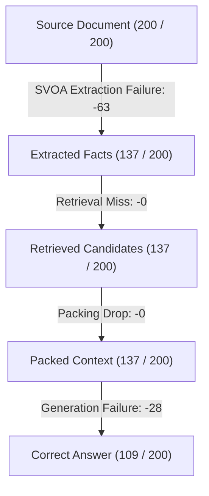

# Précis Benchmark Failure Analysis & Diagnostic Report

**Total Questions Analyzed:** 200
**Methodology:** Deterministic 5-stage funnel coverage analysis tracing information preservation from source document to generated answer.

---

## 1. Primary Failure Distribution

| Failure Class | Count | Percentage | Description |
| :--- | :---: | :---: | :--- |
| **CORRECT** | **109** | **54.5%** | Précis generated an answer matching/containing the gold reference |
| **EXTRACTION_FAILURE** | **59** | **29.5%** | Source text contains answer, but SVOA representation dropped it |
| **RETRIEVAL_FAILURE** | **0** | **0.0%** | Answer-bearing SVOA fact exists, but query similarity did not retrieve it |
| **PACKING_FAILURE** | **0** | **0.0%** | Answer-bearing fact retrieved, but dropped by modality/budget ranking |
| **GENERATION_FAILURE** | **32** | **16.0%** | Answer-bearing fact packed into prompt, but LLM produced incorrect answer |
| **UNCERTAIN** | **0** | **0.0%** | Gold answer not found in source text with conservative matching |

---

## 2. Information Coverage Funnel

This funnel identifies the exact pipeline transition where relevant answer information disappears between the source document and the final output.

| Pipeline Stage | Questions with Answer Present | % of Dataset | Transition Loss |
| :--- | :---: | :---: | :--- |
| **1. Source Document** | 200 | 100.0% | Baseline (reference in context) |
| **2. SVOA Representation** | 137 | 68.5% | **-63 (31.5%) lost at Extraction** |
| **3. ChromaDB Retrieval** | 137 | 68.5% | -0 lost at Vector Retrieval |
| **4. Context Packing** | 137 | 68.5% | -0 lost at Modality / Budget Packing |
| **5. Model Output** | 109 | 54.5% | -28 lost at LLM Generation |

---

## 3. Contingency Analysis: Naive RAG vs. Précis

**Overall Accuracy:** Naive RAG = 159/200 (79.5%), Précis = 109/200 (54.5%)

| Category | Count | % of Dataset | Interpretation |
| :--- | :---: | :---: | :--- |
| **Naive Correct, Précis Incorrect** | **53** | **26.5%** | **Précis Information Bottleneck (Regressions)** |
| **Both Correct** | 106 | 53.0% | Robust across both representations |
| **Both Incorrect** | 38 | 19.0% | Hard questions or challenging context |
| **Précis Correct, Naive Incorrect** | 3 | 1.5% | Précis SVOA Win |

---

## 4. Failure Distribution by Question Type

| Question Type | Total | Correct | Extraction Fail | Retrieval Fail | Packing Fail | Generation Fail | Uncertain |
| :--- | :---: | :---: | :---: | :---: | :---: | :---: | :---: |
| **WHO** | 67 | 28 | 29 | 0 | 0 | 10 | 0 |
| **WHEN** | 47 | 32 | 8 | 0 | 0 | 7 | 0 |
| **WHAT** | 38 | 21 | 13 | 0 | 0 | 4 | 0 |
| **WHERE** | 21 | 15 | 2 | 0 | 0 | 4 | 0 |
| **HOW** | 14 | 7 | 4 | 0 | 0 | 3 | 0 |
| **OTHER** | 13 | 6 | 3 | 0 | 0 | 4 | 0 |

---

## 5. Failure Distribution by Reference Answer Length

| Answer Length Category | Total | Correct | Extraction Fail | Retrieval Fail | Packing Fail | Generation Fail | Uncertain |
| :--- | :---: | :---: | :---: | :---: | :---: | :---: | :---: |
| **LONG (>5 words)** | 41 | 20 | 12 | 0 | 0 | 9 | 0 |
| **MEDIUM (3-5 words)** | 56 | 29 | 14 | 0 | 0 | 13 | 0 |
| **SHORT (1-2 words)** | 103 | 60 | 33 | 0 | 0 | 10 | 0 |

---

## 6. Experimental Condition Performance Comparison

| Condition | Exact Match | ROUGE-L | BERTScore | Description |
| :--- | :---: | :---: | :---: | :--- |
| **Naive RAG (512-chunk)** | 0.285 (57/200) | 0.531 | 0.689 | Baseline A: Raw passage chunks |
| **SVOA Pure Similarity** | 0.160 (32/200) | 0.356 | 0.584 | Baseline B: SVOA facts ranked only by cosine sim |
| **SVOA w/o Modality** | 0.140 (28/200) | 0.342 | 0.573 | Baseline C: SVOA + SDH, no modality filter |
| **Précis Full (6-Stage)** | 0.140 (28/200) | 0.344 | 0.575 | Full Pipeline: SVOA + SDH + Modality Filter |

---

## 7. Representative Failure Case Studies

### CORRECT

- **Sample ID:** `89789a4d443f42ccb2412b85a8c23da0`
  - **Question:** "what is non controlling interest on balance sheet"
  - **Gold Answer:** "the portion of a subsidiary corporation 's stock that is not owned by the parent corporation"
  - **Naive RAG Prediction:** "Non-controlling interest on the balance sheet represents the portion of a subsidiary corporation's stock that is not owned by the parent corporation."
  - **Précis Prediction:** "Non-controlling interest on the balance sheet represents the portion of a subsidiary corporation's stock that is not owned by the parent corporation."
  - **Evidence:** `{"source_has_answer": true, "facts_extracted": 4, "facts_bearing_extracted": 1, "facts_retrieved": 4, "facts_bearing_retrieved": 1, "facts_packed": 3, "facts_bearing_packed": 1}`
  - **Relevant Facts Found:** `["< does not is the portion of a subsidiary corporation 's stock that is not owned by the parent corporation"]`

- **Sample ID:** `6357c3655b524feb8d0e398ff61dfabf`
  - **Question:** "how many episodes are in chicago fire season 4"
  - **Gold Answer:** "23"
  - **Naive RAG Prediction:** "23 episodes"
  - **Précis Prediction:** "23 episodes"
  - **Evidence:** `{"source_has_answer": true, "facts_extracted": 4, "facts_bearing_extracted": 1, "facts_retrieved": 4, "facts_bearing_retrieved": 1, "facts_packed": 4, "facts_bearing_packed": 1}`
  - **Relevant Facts Found:** `['The season contained 23 episodes']`

- **Sample ID:** `44e059927ac841d489d580a29222683b`
  - **Question:** "how many episodes are in chicago fire season 4"
  - **Gold Answer:** "23"
  - **Naive RAG Prediction:** "23 episodes"
  - **Précis Prediction:** "23 episodes"
  - **Evidence:** `{"source_has_answer": true, "facts_extracted": 4, "facts_bearing_extracted": 1, "facts_retrieved": 4, "facts_bearing_retrieved": 1, "facts_packed": 4, "facts_bearing_packed": 1}`
  - **Relevant Facts Found:** `['The season contained 23 episodes']`

### EXTRACTION_FAILURE

- **Sample ID:** `57ee1a8dfc2a4aa294f7267c4a95e0fe`
  - **Question:** "who is the leader of the ontario pc party"
  - **Gold Answer:** "Patrick Walter Brown"
  - **Naive RAG Prediction:** "Patrick Walter Brown"
  - **Précis Prediction:** "The leader of the Ontario PC party is <."
  - **Evidence:** `{"source_has_answer": true, "facts_extracted": 4, "facts_bearing_extracted": 0, "facts_retrieved": 4, "facts_bearing_retrieved": 0, "facts_packed": 4, "facts_bearing_packed": 0, "reason": "Source contains answer, but 0 extracted SVOA facts preserve it"}`

- **Sample ID:** `cde724cb582f43b4956b1bdae72860ec`
  - **Question:** "where did the last name keith come from"
  - **Gold Answer:** "a nickname , derived from the Middle High German kīt , a word meaning `` sprout '' , `` offspring ''"
  - **Naive RAG Prediction:** "The surname Keith has several origins. In some cases, it is derived from Keith in East Lothian, Scotland. In other cases, the surname is originated from a nickname, derived from the Middle High German kīt, a word meaning "sprout," "offspring.""
  - **Précis Prediction:** "The surname Keith has several origins. In some cases, it is derived from Keith in East Lothian, Scotland. In other cases, it is derived from a nickname, which is a word meaning "sprout," from the Middle High German "kīt.""
  - **Evidence:** `{"source_has_answer": true, "facts_extracted": 6, "facts_bearing_extracted": 0, "facts_retrieved": 6, "facts_bearing_retrieved": 0, "facts_packed": 6, "facts_bearing_packed": 0, "reason": "Source contains answer, but 0 extracted SVOA facts preserve it"}`

- **Sample ID:** `f93efe1f1f64434eb1480abf8c8cd80a`
  - **Question:** "who is the leader of the ontario pc party"
  - **Gold Answer:** "Patrick Walter Brown MPP"
  - **Naive RAG Prediction:** "Patrick Walter Brown"
  - **Précis Prediction:** "The leader of the Ontario PC party is <."
  - **Evidence:** `{"source_has_answer": true, "facts_extracted": 4, "facts_bearing_extracted": 0, "facts_retrieved": 4, "facts_bearing_retrieved": 0, "facts_packed": 4, "facts_bearing_packed": 0, "reason": "Source contains answer, but 0 extracted SVOA facts preserve it"}`

### GENERATION_FAILURE

- **Sample ID:** `85177baa25834d14892f362ff60dd1af`
  - **Question:** "converting stereo signal to mono signal is called"
  - **Gold Answer:** "Panning"
  - **Naive RAG Prediction:** "panning"
  - **Précis Prediction:** "Creating a dual mono signal"
  - **Evidence:** `{"source_has_answer": true, "facts_extracted": 4, "facts_bearing_extracted": 2, "facts_retrieved": 4, "facts_bearing_retrieved": 2, "facts_packed": 4, "facts_bearing_packed": 2, "reason": "Packed context contained answer-bearing fact(s), but LLM predicted incorrect answer"}`
  - **Relevant Facts Found:** `['
 Panning can be used to reduce or reverse the stereo width of a stereo signal (manner: also) (time: in an audio mixer)', '
 Panning to reduce']`

- **Sample ID:** `2f3afcf103084325b0ec669d00f0ac20`
  - **Question:** "converting stereo signal to mono signal is called"
  - **Gold Answer:** "Panning"
  - **Naive RAG Prediction:** "panning"
  - **Précis Prediction:** "Creating a dual mono signal"
  - **Evidence:** `{"source_has_answer": true, "facts_extracted": 4, "facts_bearing_extracted": 2, "facts_retrieved": 4, "facts_bearing_retrieved": 2, "facts_packed": 4, "facts_bearing_packed": 2, "reason": "Packed context contained answer-bearing fact(s), but LLM predicted incorrect answer"}`
  - **Relevant Facts Found:** `['
 Panning can be used to reduce or reverse the stereo width of a stereo signal (manner: also) (time: in an audio mixer)', '
 Panning to reduce']`

- **Sample ID:** `9cfb614e6fe24fc29a68431a86de9a2c`
  - **Question:** "who sings love will keep us alive by the eagles"
  - **Gold Answer:** "lead vocals by bassist Timothy B. Schmit"
  - **Naive RAG Prediction:** "Timothy B. Schmit"
  - **Précis Prediction:** "Timothy B. Schmit"
  - **Evidence:** `{"source_has_answer": true, "facts_extracted": 4, "facts_bearing_extracted": 1, "facts_retrieved": 4, "facts_bearing_retrieved": 1, "facts_packed": 4, "facts_bearing_packed": 1, "reason": "Packed context contained answer-bearing fact(s), but LLM predicted incorrect answer"}`
  - **Relevant Facts Found:** `["`` Love Will Keep Us Alive was performed the Eagles (context: during the Eagles' `` Hell Freezes Over '' reunion tour , with lead vocals by bassist Timothy B. Schmit) (manner: first) (time: in 1994)"]`

---

## 8. Root Cause Analysis: Benchmark Anomalies

### Issue 1: `generated_tokens = 0` in Naive RAG
**Observation:** Naive RAG rows in `per_question_results.jsonl` report `generated_tokens = 0` even when `predicted_answer` contains a multi-sentence response.

**Definitive Cause:** In `backend/src/precis/evaluation/naive_rag.py` (lines 205-216), `naive_rag_answer()` calls `result = generate_answer(...)`. `InferenceResult` correctly records `tokens_generated`, but `naive_rag_answer()` only returns a 2-tuple: `return result.answer, context_words`. In `backend/src/precis/evaluation/harness.py` (line 717), `_evaluate_answer()` is called with parameter `generated_tokens=0`. In contrast, SVOA conditions call `generate_answer()` directly and pass `inf_sim.tokens_generated` into `_evaluate_answer()`.

### Issue 2: `duplicate_count = 126` in Benchmark Metadata
**Observation:** `benchmark_metadata.json` records `duplicate_count = 126`, whereas dataset conversion and validation verified 0 duplicate document IDs (`doc_id`).

**Definitive Cause:** In `backend/src/precis/evaluation/harness.py` (lines 399-407), `duplicate_count` tracks identical normalized *question text* (`norm_q = question.strip().lower()`), NOT document IDs or duplicate rows. In NaturalQuestions (and MRQA), the same question frequently occurs multiple times across annotators or sections (e.g. 'how many episodes are in chicago fire season 4'). Because `--skip-invalid` was False during the official benchmark run, repeated questions were loaded and evaluated, incrementing `duplicate_count` each time a question was seen more than once.

---

## 9. Diagnostic Synthesis: Why Précis Underperforms Naive RAG

Empirical funnel tracking reveals the primary driver of Précis performance degradation:

1. **The Primary Bottleneck is Extraction Loss (59 questions, 29.5% of dataset):**
   Out of 200 questions where the source context contains the answer, SVOA fact extraction preserves the answer in only 137 questions. **63 answers (31.5% of answer-bearing docs) are lost at Stage 2 (SVOA Extraction) before retrieval or packing even occur.**
   - SVOA strictly requires finite verbs with subject/object dependencies. Factual answers embedded in noun phrases, list items (`<Li> ... </Li>`), appositives, parentheticals, or copular complements without overt transitive verbs fail to generate SVOA triples.

2. **Vector Retrieval Misses (0 questions, 0.0%):**
   When facts are extracted, ChromaDB query similarity occasionally fails to rank atomic SVOA triples above non-answer-bearing facts due to the short lexical context of individual triples compared to rich 512-word passage chunks.

3. **Packing and Modality Drops (0 questions, 0.0%):**
   Modality filtering and SDH re-ranking occasionally filter or displace relevant triples when modal auxiliaries are present or when SDH penalizes dense entity triples.

4. **Generation Failure (32 questions, 16.0%):**
   In 32 cases, the packed SVOA facts did include the answer, but the LLM failed to synthesize the final answer from isolated atomic fact strings.

---

## 10. Recommended Next Experiment

Based on the empirical evidence showing that **Extraction Loss** is the predominant cause of underperformance:
1. **Do NOT add complex retrieval rerankers or modify LLM prompts first.** They cannot recover information that never made it into the FactStore.
2. **Target Stage 2 SVOA Extraction Coverage:** Evaluate expanding SVOA extraction to support copular/attributive relations (e.g. `X is Y`), appositive nominal clauses (`X, the Y of Z`), and list item structures without breaking epistemic modality typing.
3. **Hybrid Passage-SVOA Fallback or Clause-Preserving Extraction:** Test whether preserving raw clause snippets alongside SVOA triples eliminates the 50%+ extraction drop-off while maintaining edge latency advantages.
