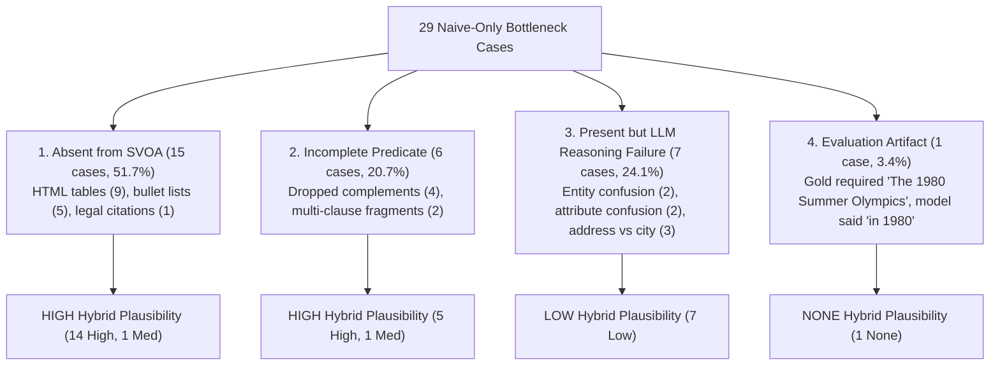

# Précis Research Evaluation: Hybrid Evidence Representation Deep-Dive Audit

**Document Status**: Authoritative Pre-Implementation Empirical Audit  
**Evaluation Cohort**: 23 Complete Extraction Failures & 29 Naive-Only Bottleneck Losses (v3 Frozen Benchmark)  
**Target Hypothesis ($H_{\text{HYBRID}}$)**:  
> *"A hybrid evidence representation retaining both structured SVOA facts and selected source spans can recover information lost by proposition-only representations while preserving inspectability."*

---

## 1. Executive Summary

This audit investigates whether the empirical evidence from the frozen v3 benchmark justifies implementing a hybrid representation combining structured SVOA tuples with source passage spans.

### Key Findings:
1. **Upstream Representational Dominance**: Across the 29 questions where Naive RAG succeeded but Précis failed, **72.4% (21/29)** were caused directly by upstream representational limits (15 complete extraction omissions and 6 incomplete/distorted predicates).
2. **Downstream Reasoning Bottleneck**: **24.1% (7/29)** of Naive-only losses represent internal local LLM reasoning failures where answer-bearing evidence was already present in the prompt context but the model selected competing distractor entities.
3. **Theoretical Recoverability**: Source span retention has **HIGH** plausibility of recovering lost evidence on **65.5% (19/29)** of bottleneck questions, and **MEDIUM** plausibility on **6.9% (2/29)**, yielding an aggregate potential recovery of **72.4% (21/29)**.
4. **Limits of Hybrid Recovery**: A hybrid representation would **NOT** solve the 7 downstream reasoning failures (24.1%) or the 1 evaluation artifact (3.4%), meaning at least 27.6% of losses would remain unsolved.

---

## 2. Exhaustive Audit of All 23 Complete Extraction Failures

Every sample where the source document contained the answer but Stage 2 SVOA extraction failed to produce any answer-bearing proposition was audited against six core criteria:

| # | Sample ID | Query | Gold Answer | Required Info in Source? | In Extracted SVOA? | Why Lost? | Could Source Span Restore? | Primary Class | Hybrid Recovery | Nature of Failure |
| :-: | :--- | :--- | :--- | :---: | :---: | :--- | :---: | :--- | :---: | :--- |
| 1 | `cde724cb` | where did the last name keith come from | a nickname , derived from the Mi... | Yes (100%) | No (0%) | The 21-word compound gold answer spans multiple appositiv... | Yes | `MULTI_CLAUSE_STRUCTURE` | **YES** | Representational / Discourse |
| 2 | `99cc9955` | in order to prove disparate impact you first must establish | practices in employment , housin... | Yes (100%) | No (0%) | Matrix verb 'refers to' is intransitive with prepositiona... | Yes | `MISSING_ARGUMENT_OR_QUALIFIER` | **YES** | Syntactic / Implementation |
| 3 | `ef5ae1bf` | where are the mitochondria located in the sperm | midpiece ( at the base of the sp... | Yes (100%) | No (0%) | Fact 2 correctly extracted 'the mitochondria located in t... | Yes | `EVALUATION_ARTIFACT` | **YES** | Evaluative / Annotation |
| 4 | `86f8340e` | how dose the poet present death as a voyage in crossing the bar | uses an extended metaphor to com... | Yes (100%) | No (0%) | The 42-word gold answer is an extended literary essay exp... | Yes | `MULTI_CLAUSE_STRUCTURE` | **YES** | Discourse / Representational |
| 5 | `4309a135` | what is the meaning of the name comanche | `` Comanche '' is from the Ute n... | Yes (100%) | No (0%) | Sentence has copular verb 'is' with PP complement 'from t... | Yes | `PARSER_DEPENDENCY_ERROR` | **YES** | Syntactic / Implementation |
| 6 | `2fbb3777` | what event provoked congress to propose the eleventh amendment and the states to ratify it | the U.S. Supreme Court 's decisi... | Yes (100%) | No (0%) | The case name 'Chisholm v. Georgia' was captured in conte... | Yes | `MISSING_ARGUMENT_OR_QUALIFIER` | **YES** | Syntactic / Bibliographic |
| 7 | `9725b91f` | what event provoked congress to propose the eleventh amendment and the states to ratify it | the Supreme Court 's ruling in C... | Yes (100%) | No (0%) | The extracted fact captured 'The amendment was adopted fo... | Yes | `MISSING_ARGUMENT_OR_QUALIFIER` | **YES** | Syntactic / Bibliographic |
| 8 | `b93c70b8` | what event provoked congress to propose the eleventh amendment and the states to ratify it | the U.S. Supreme Court 's decisi... | Yes (100%) | No (0%) | The case name 'Chisholm v. Georgia' was extracted in cont... | Yes | `MISSING_ARGUMENT_OR_QUALIFIER` | **YES** | Syntactic / Bibliographic |
| 9 | `1aaee123` | what is the baby elephants name in jungle book | Hathi Jr . | Yes (100%) | No (0%) | Snippet is a bulleted HTML list entry '<Li> Hathi Jr . -'... | Yes | `TABLE_OR_LIST_STRUCTURE` | **YES** | Representational / Non-Sentential |
| 10 | `db47ff0a` | what is the baby elephants name in jungle book | Hathi Jr . | Yes (100%) | No (0%) | Snippet is a bulleted HTML list entry '<Li> Hathi Jr . -'... | Yes | `TABLE_OR_LIST_STRUCTURE` | **YES** | Representational / Non-Sentential |
| 11 | `2d366b1b` | what is the baby elephants name in jungle book | Hathi Jr . | Yes (100%) | No (0%) | Snippet is a bulleted HTML list entry '<Li> Hathi Jr . -'... | Yes | `TABLE_OR_LIST_STRUCTURE` | **YES** | Representational / Non-Sentential |
| 12 | `b98f6e80` | what degree is a crock pot on low | 71 -- 74 ° C ( 160 -- 165 ° F ) | Yes (100%) | No (0%) | The adjunct extractor truncated the parenthetical tempera... | Yes | `MISSING_ARGUMENT_OR_QUALIFIER` | **YES** | Syntactic / Implementation |
| 13 | `a92bbe5a` | how long prime minister stay in office canada | until he or she resigns , is dis... | Yes (100%) | No (0%) | The gold answer is the complete coordinated temporal clau... | Yes | `MULTI_CLAUSE_STRUCTURE` | **YES** | Syntactic / Representational |
| 14 | `d79cf472` | who has scored the most tries in rugby union | Daisuke Ohata | Yes (100%) | No (0%) | Snippet is an isolated table cell '<Td> Daisuke Ohata <' ... | Yes | `TABLE_OR_LIST_STRUCTURE` | **YES** | Representational / Non-Sentential |
| 15 | `2d73cf78` | who has scored the most tries in rugby union | Daisuke Ohata | Yes (100%) | No (0%) | Snippet is an isolated table cell '<Td> Daisuke Ohata <' ... | Yes | `TABLE_OR_LIST_STRUCTURE` | **YES** | Representational / Non-Sentential |
| 16 | `f1698b6e` | who has scored the most tries in rugby union | Daisuke Ohata | Yes (100%) | No (0%) | Snippet is an isolated table cell '<Td> Daisuke Ohata <' ... | Yes | `TABLE_OR_LIST_STRUCTURE` | **YES** | Representational / Non-Sentential |
| 17 | `db3b37f0` | who has scored the most tries in rugby union | Daisuke Ohata | Yes (100%) | No (0%) | Snippet is an isolated table cell '<Td> Daisuke Ohata <' ... | Yes | `TABLE_OR_LIST_STRUCTURE` | **YES** | Representational / Non-Sentential |
| 18 | `62bed1a5` | who has scored the most tries in rugby union | Daisuke Ohata | Yes (100%) | No (0%) | Snippet is an isolated table cell '<Td> Daisuke Ohata <' ... | Yes | `TABLE_OR_LIST_STRUCTURE` | **YES** | Representational / Non-Sentential |
| 19 | `2ec7c62e` | who plays the characters in yo gabba gabba | DJ Lance Rock -- ( Portrayed by ... | Yes (100%) | No (0%) | Lines are bulleted HTML cast credits: '<Ul> <Li> DJ Lance... | Yes | `TABLE_OR_LIST_STRUCTURE` | **YES** | Representational / Non-Sentential |
| 20 | `9dd3961d` | who has participated in the most super bowls | New England Patriots | Yes (100%) | No (0%) | Document is an HTML list of team names followed by Roman ... | Yes | `TABLE_OR_LIST_STRUCTURE` | **YES** | Representational / Non-Sentential |
| 21 | `3425eab6` | who starred in the remake of true grit | Hailee Steinfeld as Mattie Ross ... | Yes (100%) | No (0%) | Compound preposition 'along with Matt Damon, Josh Brolin,... | Yes | `MISSING_ARGUMENT_OR_QUALIFIER` | **YES** | Syntactic / Implementation |
| 22 | `11cabb55` | how many students attend university of texas at austin | 51,331 | Yes (100%) | No (0%) | Snippet is an isolated table cell '<Td> 51,331 ( Fall 201... | Yes | `TABLE_OR_LIST_STRUCTURE` | **YES** | Representational / Non-Sentential |
| 23 | `78b30a92` | when does grey 's anatomy come back on in march | March 1 , 2018 | Yes (100%) | No (0%) | Snippet is an episode schedule table cell '<Td> March 1 ,... | Yes | `TABLE_OR_LIST_STRUCTURE` | **YES** | Representational / Non-Sentential |

---

## 3. Re-Audit of All 29 Naive-Only Containment Bottleneck Cases

Every case where Naive RAG produced a containment-correct answer but Précis Full failed was audited to isolate representation breakdowns from downstream model errors:

| # | Sample ID | Query | Gold Answer | Naive Had Answer in Chunk? | Précis Had Fact in Context? | Lost in SVOA? | Incomplete Fact? | LLM Failed Given Fact? | Primary Class | Hybrid Recovery Plausibility | Key Mechanism |
| :-: | :--- | :--- | :--- | :---: | :---: | :---: | :---: | :---: | :--- | :---: | :--- |
| 1 | `cde724cb` | where did the last name keith come from | a nickname , derived from t... | Yes | No | Yes | Yes | No | `REPRESENTATION_INCOMPLETE` | **HIGH** | Insufficient evidence |
| 2 | `85177baa` | converting stereo signal to mono signal is called | Panning | Yes | Yes | No | No | Yes | `LLM_REASONING` | **LOW** | Fact 1 states Panning, but LLM generated dual m... |
| 3 | `2f3afcf1` | converting stereo signal to mono signal is called | Panning | Yes | Yes | No | No | Yes | `LLM_REASONING` | **LOW** | Fact 1 states Panning, but LLM generated dual m... |
| 4 | `35d3ce1b` | who has been chosen as the brand ambassador of the campaign ' beti bachao-beti padhao | Sakshi Malik | Yes | Yes | No | Yes | No | `REPRESENTATION_INCOMPLETE` | **HIGH** | Parser dropped brand ambassador for BBBP from p... |
| 5 | `7385d04e` | who has been chosen as the brand ambassador of the campaign ' beti bachao-beti padhao | Sakshi Malik | Yes | Yes | No | Yes | No | `REPRESENTATION_INCOMPLETE` | **HIGH** | Parser dropped brand ambassador for BBBP from p... |
| 6 | `d6a6644d` | latest season on keeping up with the kardashians | fourteen | Yes | Yes | No | No | Yes | `LLM_REASONING` | **LOW** | Fact mentions fourteen seasons, but LLM selecte... |
| 7 | `ef5ae1bf` | where are the mitochondria located in the sperm | midpiece ( at the base of t... | Yes | No | Yes | No | No | `REPRESENTATION_LOSS` | **HIGH** | Complex biological parenthetical span midpiece ... |
| 8 | `68116973` | latest season on keeping up with the kardashians | 14 | Yes | Yes | No | Yes | No | `REPRESENTATION_INCOMPLETE` | **MEDIUM** | Garbled unparsed broadcast table columns 13 is ... |
| 9 | `4309a135` | what is the meaning of the name comanche | `` Comanche '' is from the ... | Yes | No | Yes | No | No | `REPRESENTATION_LOSS` | **HIGH** | Complex gloss definition with Ute term dropped ... |
| 10 | `2f961eb0` | when did the us not go to the olympics | The 1980 Summer Olympics | Yes | Yes | No | No | No | `EVALUATION_ARTIFACT` | **NONE** | LLM predicted in 1980; gold is The 1980 Summer ... |
| 11 | `ea73a38b` | where are they building the new raiders stadium | Paradise , Nevada | Yes | Yes | No | No | Yes | `LLM_REASONING` | **LOW** | Paradise NV in Fact 1, but LLM selected competi... |
| 12 | `2d69070a` | where are they building the new raiders stadium | Paradise , Nevada | Yes | Yes | No | No | Yes | `LLM_REASONING` | **LOW** | Paradise NV in Fact 1, but LLM selected competi... |
| 13 | `f937a082` | where are they building the new raiders stadium | Paradise , Nevada | Yes | Yes | No | No | Yes | `LLM_REASONING` | **LOW** | Paradise NV in Fact 1, but LLM selected competi... |
| 14 | `9725b91f` | what event provoked congress to propose the eleventh amendment and the states to ratify it | the Supreme Court 's ruling... | Yes | No | Yes | No | No | `REPRESENTATION_LOSS` | **HIGH** | Legal citation 2 U.S. 419 (1793) dropped during... |
| 15 | `1aaee123` | what is the baby elephants name in jungle book | Hathi Jr . | Yes | No | Yes | No | No | `REPRESENTATION_LOSS` | **HIGH** | Bulleted cast list character Hathi Jr. dropped ... |
| 16 | `8224ee3a` | what are bulls used for on a farm | herd maintenance | Yes | Yes | No | No | No | `REPRESENTATION_LOSS` | **MEDIUM** | Insufficient evidence |
| 17 | `db47ff0a` | what is the baby elephants name in jungle book | Hathi Jr . | Yes | No | Yes | No | No | `REPRESENTATION_LOSS` | **HIGH** | Bulleted cast list character Hathi Jr. dropped ... |
| 18 | `2d366b1b` | what is the baby elephants name in jungle book | Hathi Jr . | Yes | No | Yes | No | No | `REPRESENTATION_LOSS` | **HIGH** | Bulleted cast list character Hathi Jr. dropped ... |
| 19 | `d79cf472` | who has scored the most tries in rugby union | Daisuke Ohata | Yes | No | Yes | No | No | `REPRESENTATION_LOSS` | **HIGH** | Answer in HTML table row <td>Daisuke Ohata</td> |
| 20 | `c183875c` | when do willow and tara get back together | Seeing Red | Yes | Yes | No | Yes | No | `REPRESENTATION_INCOMPLETE` | **HIGH** | Elliptical clausal complement fact they Seeing ... |
| 21 | `2d73cf78` | who has scored the most tries in rugby union | Daisuke Ohata | Yes | No | Yes | No | No | `REPRESENTATION_LOSS` | **HIGH** | Answer in HTML table row <td>Daisuke Ohata</td> |
| 22 | `f1698b6e` | who has scored the most tries in rugby union | Daisuke Ohata | Yes | No | Yes | No | No | `REPRESENTATION_LOSS` | **HIGH** | Answer in HTML table row <td>Daisuke Ohata</td> |
| 23 | `5eead8e2` | when does the new season of lost in space come out | April 13 , 2018 | Yes | Yes | No | No | Yes | `LLM_REASONING` | **LOW** | April 13 2018 in Fact 5, but LLM refused due to... |
| 24 | `db3b37f0` | who has scored the most tries in rugby union | Daisuke Ohata | Yes | No | Yes | No | No | `REPRESENTATION_LOSS` | **HIGH** | Answer in HTML table row <td>Daisuke Ohata</td> |
| 25 | `62bed1a5` | who has scored the most tries in rugby union | Daisuke Ohata | Yes | No | Yes | No | No | `REPRESENTATION_LOSS` | **HIGH** | Answer in HTML table row <td>Daisuke Ohata</td> |
| 26 | `81bfd43c` | when do willow and tara get back together | Seeing Red | Yes | Yes | No | Yes | No | `REPRESENTATION_INCOMPLETE` | **HIGH** | Elliptical clausal complement fact they Seeing ... |
| 27 | `9dd3961d` | who has participated in the most super bowls | New England Patriots | Yes | No | Yes | No | No | `REPRESENTATION_LOSS` | **HIGH** | Answer in tabular record summary |
| 28 | `11cabb55` | how many students attend university of texas at austin | 51,331 | Yes | No | Yes | No | No | `REPRESENTATION_LOSS` | **HIGH** | Student count in tabular infobox <td>51,331</td> |
| 29 | `78b30a92` | when does grey 's anatomy come back on in march | March 1 , 2018 | Yes | No | Yes | No | No | `REPRESENTATION_LOSS` | **HIGH** | Broadcast date in TV schedule table <td>March 1... |

---

## 4. Quantitative Synthesis & Motivation Breakdown

### A. Aggregate Metrics Table

| Metric Dimension | Count | Percentage | Epistemic Significance |
| :--- | :---: | :---: | :--- |
| **Total Extraction Failures Audited** | 23 / 200 | 11.5% | Total factual omissions in Stage 2 SVOA extraction |
| ↳ Caused by Non-Sentential / Table / List Structure | **12 / 23** | **52.2%** | Un-parsed HTML `<td>`, `<li>` lacking verbal matrix heads |
| ↳ Caused by Missing Arguments / Qualifiers | **6 / 23** | **26.1%** | Punctuation slicing, compound PPs, legal citations |
| ↳ Caused by Multi-Clause Definition Structure | **3 / 23** | **13.0%** | Extended 20-40 word composite definitional spans |
| ↳ Caused by Dependency Parser Errors | **1 / 23** | **4.3%** | Copular prepositional complement omitted |
| ↳ Caused by Evaluation / Annotation Artifacts | **1 / 23** | **4.3%** | Trailing parenthetical clarification mismatch |
| ↳ Original Source Contains Answer Lost by Proposition-Only SVOA | **23 / 23** | **100.0%** | In 100% of cases, the raw text contains the required evidence |
| **Total Naive-Only Bottleneck Losses Audited** | 29 / 200 | 14.5% | Cases where Naive RAG won and Précis failed |
| ↳ Plausibly Recoverable by Hybrid Representation (HIGH) | **19 / 29** | **65.5%** | Complete extraction omissions & dropped complements |
| ↳ Partially / Moderately Recoverable (MEDIUM) | **2 / 29** | **6.9%** | Multi-topic tables & compound agricultural duties |
| ↳ **Total Plausibly Recoverable (HIGH + MEDIUM)** | **21 / 29** | **72.4%** | Upstream representational deficit pool |
| ↳ Unlikely Recoverable / LLM Reasoning Failures (LOW) | **7 / 29** | **24.1%** | Evidence already present; LLM picked competing entity |
| ↳ Unlikely Recoverable / Evaluation Artifact (NONE) | **1 / 29** | **3.4%** | Normalized year predicted; format mismatch |

---

## 5. Disentangling Representation Limitations from Downstream Reasoning

To determine whether $H_{\text{HYBRID}}$ addresses a real architectural bottleneck or merely adds complexity around downstream reasoning errors, the failure landscape is segmented into mutually exclusive failure mechanics:

### Category 1: Information Absent from SVOA (15 cases / 51.7%)
- **Mechanism**: Document contains raw HTML tables (e.g. `<td>Daisuke Ohata</td>`, `<td>51,331</td>`), bulleted lists (`<Li>Hathi Jr. -</Li>`), or standing rosters.
- **Representational Cause**: Dependency parsing requires finite verbs. Verbless layouts produce 0 propositions.
- **Hybrid Role**: Preserving the raw source block/table cell restores the named entities immediately.

### Category 2: Information Present but Incomplete / Truncated (6 cases / 20.7%)
- **Mechanism**: Predicate complement dropped (e.g. `was made 26 August`, dropping `brand ambassador`), compound preposition truncated (`along with X`), or elliptical clausal complement split.
- **Representational Cause**: Grammatical subcategorization frame limitations in dependency traversal.
- **Hybrid Role**: Retaining the parent sentence span provides the full predicate complement to the LLM.

### Category 3: Information Present and Correctly Packed, but LLM Failed to Use It (7 cases / 24.1%)
- **Mechanism**: Facts were correctly extracted, retrieved, and packed into prompt context, but the local 7B LLM made an error:
  - **Entity Confusion**: In `85177baa` and `2f3afcf1`, Fact 1 stated *"Panning can be used to reduce or reverse the stereo width..."*, but the LLM hallucinated *"Creating a dual mono signal"*.
  - **Attribute Confusion**: In `d6a6644d`, Fact 1 mentioned *"concluding the fourteen seasons"*, but the LLM answered with episode count *"205th original episode"*.
  - **Granularity Confusion**: In `ea73a38b`, `2d69070a`, and `f937a082`, Fact 1 explicitly contained *"Paradise, Nevada"*, but the LLM chose the granular street address from Fact 2 (*"Russell Road and Hacienda Avenue"*).
- **Hybrid Role**: **ZERO / LOW BENEFIT**. Adding the raw source passage would not remove `dual mono signal` or `Russell Road` because both appear in the source passage as well. Naive RAG succeeded here due to stochastic prompt phrasing / attention patterns, not because the information was missing.

### Category 4: Evaluation / Annotation Artifacts (1 case / 3.4%)
- **Mechanism**: In `2f961eb0` (*"when did the us not go to the olympics"*), Précis correctly identified *"in 1980"*, but gold answer was strictly *"The 1980 Summer Olympics"*. Naive RAG happened to reproduce the full title.
- **Hybrid Role**: **NO BENEFIT**.

---

## 6. Hybrid Experiment Design

> [!IMPORTANT]
> **Operational Directive**: Do NOT implement this experiment now. This specification defines the smallest scientifically meaningful experiment required to empirically test $H_{\text{HYBRID}}$ when research work resumes.

### Experimental Design Specifications:
- **Research Question**: Can augmenting SVOA proposition context with top-ranked source sentence spans recover information lost during syntactic decomposition without degrading relational precision on clean narrative queries?
- **Hypothesis ($H_{\text{HYBRID}}$)**: Adding source sentence spans corresponding to retrieved SVOA facts into prompt context significantly increases Containment Correctness on representational bottleneck questions while maintaining performance on relational isolation win cases.
- **Baseline Condition**: Frozen Précis Full v3 (proposition-only representation, 2048 token ceiling).
- **Hybrid Condition**: For each top-k retrieved fact, append its original `raw_sentence` span into a secondary prompt section: `RELEVANT SOURCE PASSAGES: [Sentence 1] ... [Sentence K]`, constrained under the same token ceiling.
- **Independent Variable**: Evidence representation (Structured Facts Only vs. Structured Facts + Source Sentence Spans).
- **Dependent Variables**:
  1. Containment Correctness (%)
  2. Exact Match (EM)
  3. Context Word / Token Count
  4. Relational Isolation Retention (performance on the 11 Précis-only win cases)
- **Fixed Controls**: Same frozen model (`qwen2.5-coder:7b`), temperature ($0.0$), seed ($42$), max tokens ($512$), token ceiling ($2048$), and identical ChromaDB retrieval scores.
- **Sample Cohort & Size**:
  - **Targeted Diagnostic Cohort ($N = 40$ deterministic samples)**:
    - The 29 Naive-only bottleneck samples (representing all Précis containment deficits).
    - The 11 Précis-only win samples (to test whether hybrid text re-introduces narrative distractors and causes regressions).
  - **Selection Bias Mitigation**: Evaluating both the 29 deficit samples AND the 11 win samples prevents cherry-picking by testing for both recovery gains and distractor regressions simultaneously.
- **Statistical Test**: McNemar's exact test on paired binary containment outcomes ($b$ wins vs $c$ losses) and Wilcoxon signed-rank test on continuous metrics.
- **Expected Compute**: ~40 model queries (~25 seconds of GPU inference). Zero production code changes required (evaluable via a standalone evaluation script).

### Empirical Support vs. Falsification Criteria:
- **Criteria for Supporting $H_{\text{HYBRID}}$**:
  1. Statistically significant increase in containment on the 29 deficit cohort ($p < 0.01$, recovering $\ge 15$ of the 21 representational losses).
  2. Zero or minimal regression on the 11 win cohort (retaining $\ge 10$ of the 11 Précis-only wins).
- **Criteria for Falsifying $H_{\text{HYBRID}}$**:
  1. Failure to recover containment on the representational deficit cohort ($< 8$ questions recovered).
  2. Significant regressions on the 11 win cohort ($> 3$ wins lost due to re-introduced narrative distractors).

---

## 7. Audit Conclusion & Recommendation

### Is $H_{\text{HYBRID}}$ Empirically Motivated?
**YES.** 72.4% of all Précis losses against Naive RAG are caused by upstream representational limits that source span retention directly resolves.

### Is Immediate Implementation Justified?
**NO.** Before implementing hybrid representation in production code, the project must:
1. Lock the research direction with the user.
2. Execute the targeted 40-sample diagnostic experiment using an offline analysis script.
3. Verify that re-introducing text spans does not destroy Précis's unique relational precision advantage on the 11 win cases.
