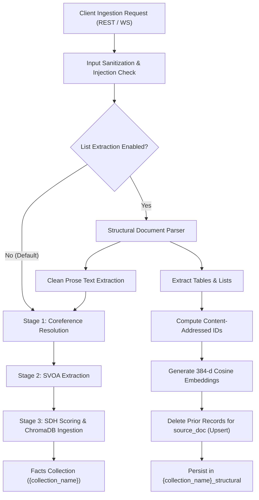
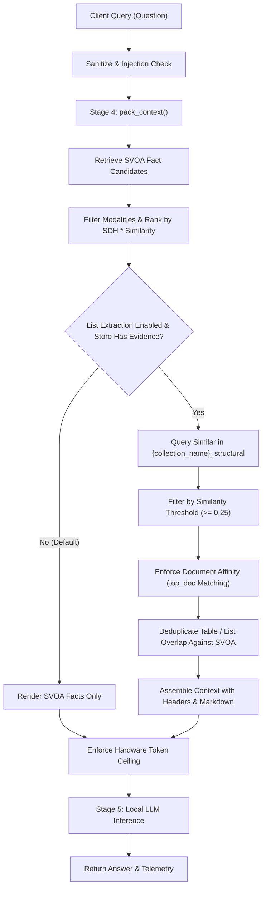

# Architecture and Data Flow: Persistent Structural Evidence Integration

**Experiment 4.5.2**  
**Date**: 2026-10-10  
**Status**: Implemented and Validated

---

## 1. Architectural Overview

Précis is designed for resource-constrained edge devices (6–8 CPU cores, 16 GB RAM, no GPU) to answer questions from unstructured documents with high fidelity and low token consumption. While atomic SVOA (Subject-Verb-Object-Adjunct) extraction excels at relational facts, unstructured lists (such as executive rosters, product specifications, and hierarchical taxonomies) often resist atomic decomposition.

Experiment 4.5.2 integrates structural evidence persistence into the core pipeline:

```
[Raw Document (HTML / Text)]
         |
   +-----+-------------------------+
   | (Disabled Mode)               | (Enabled Mode: PRECIS_ENABLE_LIST_EXTRACTION=true)
   v                               v
[SVOA Extraction Pipeline]    [Structural Extraction Pipeline]
   | (Stage 1-3)                   | (Table chunks & List blocks)
   v                               v
[ChromaDB Facts Collection]   [ChromaDB Structural Collection]
   ({collection_name})             ({collection_name}_structural)
         \                               /
          \                             /
           v                           v
          [Stage 4: Unified Context Construction]
                       |
               [Hardware Token Clamp]
                       |
               [Local LLM Inference]
```

---

## 2. Dual-Collection Storage Design

Rather than forcing complex multi-line markdown structures into the atomic SVOA schema or adding a secondary database (such as SQLite or PostgreSQL), Précis utilizes a **dual-collection architecture** within the existing ChromaDB client instance:

1. **Facts Collection (`{collection_name}`)**:
   - Stores individual SVOA triples (`Fact` instances).
   - Embedding: `SentenceTransformer("all-MiniLM-L6-v2")` (384 dimensions, cosine distance).
   - Metadata: `subject`, `verb`, `object`, `negated`, `modality`, `sdh_score`, `source_doc`.
2. **Structural Collection (`{collection_name}_structural`)**:
   - Stores coherent Markdown table chunks and indented list blocks (`StructuralEvidence` instances).
   - Embedding: Same `SentenceTransformer("all-MiniLM-L6-v2")` (384 dimensions, cosine distance).
   - Searchable Text: Table captions, column headers, and hierarchical parent prefixes.
   - Metadata: `source_doc`, `structure_type`, `block_id`, `item_count`, `order_index`.

This guarantees:
- **No Namespace Collisions**: Querying atomic facts never retrieves multi-line table chunks by accident.
- **Shared Footprint**: Single ChromaDB client and embedded storage directory.
- **Synchronous Lifecycle**: `delete_document()` and `clear()` operate across both collections in a single call.

---

## 3. Ingestion Data Flow

The diagram below details the ingestion data flow when a document is ingested via `POST /api/ingest` or the WebSocket `/ws` connection:



---

## 4. Query Data Flow

When a client queries the system via `POST /api/query` or WebSocket `/ws`:



---

## 5. Document Lifecycle & Isolation Guarantees

1. **Re-Ingestion Guarantee**:
   When a document is re-ingested with modified contents:
   ```python
   docs = {it.source_doc for it in items if it.source_doc}
   for doc in docs:
       self.delete_structural_evidence(doc)
   ```
   All existing structural chunks for that `source_doc` are purged before new chunks are written. This prevents ghost or stale chunks from accumulating.
2. **Deterministic Hashing**:
   Record IDs use SHA-256 hashes of the formatted chunk content:
   `rec_id = f"{doc_slug}_struct_{type}_{block_id}_{chunk_idx}_{hash}"`
   Re-ingesting unchanged documents produces identical IDs.
3. **Multi-Document Isolation**:
   When `assemble_structural_query_context` retrieves structural evidence, it identifies the `top_doc` from the highest-scoring SVOA facts for the query. If `top_doc` contains relevant structural evidence, it is prioritized and isolated, preventing unrelated documents from leaking into the assembled prompt.
