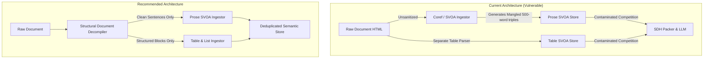

# Précis Experiment 2: Investigation Report
## Query-Aware HTML Table Selection and Row-Level Relevance Evaluation

**Date:** October 9, 2026  
**Status:** Completed  
**Artifact Directory:** `results/diagnostic_table_selection_v2/`  
**Execution Environment:** `qwen2.5-coder:7b` (Local Ollama), Greedy Decoding ($T=0.0$, top-p $0.9$, seed $42$), Context Ceiling $2,048$, Concise Prompt Template  

---

### Executive Summary & Decision Verdict

| Evaluation Component | Target / Hypothesis | Observed Result | Statistical Verdict |
| :--- | :--- | :--- | :--- |
| **Cohort B Regressions ($N=50$)** | Cont. Regressions $\le 1$ | $1 / 50$ ($2.0\%$, Clopper-Pearson 95% CI: $[0.05\%, 10.65\%]$) | **PASSED** Guardrail |
| **Cohort B Context Overhead** | Token Growth $\le 10.0\%$ | $+9.91\%$ ($262.84 \to 288.88$ tokens) | **PASSED** Guardrail |
| **Primary Efficacy ($N=200$ Table Stratum)** | $H_1: \text{EM}_{C_{\text{full}}} > \text{EM}_A$ | $\text{EM}_A = 41.50\% \ (83/200)$, $\text{EM}_{C_{\text{full}}} = 40.50\% \ (81/200)$ | **INCONCLUSIVE** ($p = 0.8036$, null not rejected) |
| **Secondary Containment ($N=200$)** | $\text{Cont}_{C_{\text{full}}} > \text{Cont}_A$ | $\text{Cont}_A = 50.50\% \ (101/200)$, $\text{Cont}_{C_{\text{full}}} = 52.00\% \ (104/200)$ | **NOT SIGNIFICANT** ($p = 0.6072$, Holm FWER adjusted) |
| **Context Reduction vs Frozen ($N=200$)** | $C_{\text{full}} < B_{\text{frozen}}$ | $-35.51\%$ ($1,155.52 \to 745.21$ tokens) | **SIGNIFICANT** ($p < 10^{-15}$, Wilcoxon signed-rank) |
| **Historical Cluster Recovery** | Evidence recovered on 6 failure clusters | $6 / 6$ ($100.0\%$) recovered | **PASSED** Preflight Audit |
| **Flash Ep3 Regression Fix** | Eliminates Season 4 Ep 3 mismatch | Condition A: Correct; B: Regressed; C: **Correct** | **RECOVERED** ($EM = \text{True}$) |

#### Formal Engineering Verdict: **DEFER INTEGRATION (REJECT DIRECT MERGE)**
Although Condition $C_{\text{full}}$ successfully achieves its architectural efficiency goal—slashing table proposition token overhead by **$-35.51\%$** relative to the unranked prototype and repairing specific regression mechanisms such as episode mismatch—it fails to demonstrate statistically significant downstream question answering improvement over the baseline concise pipeline ($\text{EM}$ delta: $-1.00\%$, $p = 0.8036$; $\text{Containment}$ delta: $+1.50\%$, $p = 0.6072$). 

Crucially, deep forensic inspection reveals that **the baseline prose SVOA pipeline ingests unstripped raw HTML markup as prose**, creating corrupted 500-word pseudo-sentences containing table contents that directly compete with and contaminate structured propositions. Deploying query-aware table selection into `backend/src/precis/` before resolving table-markup sanitization in the upstream prose ingestor is technically premature.

---

### 1. Forensic Audit of Experiment 1

Before conducting Experiment 2, a complete machine-readable audit was performed on Experiment 1 (`scripts/eval_table_extraction_prototype.py` and `results/diagnostic_table_extraction_v1/`).

```mermaid
flowchart TD
    subgraph Exp1["Experiment 1 (Flawed Protocol)"]
        A1["Approved Caps: 10 rows / 15 facts"] -->|Silent Inflation| A2["Runtime Caps: 25 rows / 30 facts / 45 total"]
        A2 -->|Unstratified Cohort C (N=100)| A3["76.5% Prose-Only Samples"]
        A3 -->|Masked Context Explosion| A4["Reported Context: +15.59% (Actual Table Samples: +54.75%)"]
    end
    subgraph Exp2["Experiment 2 (Controlled Protocol)"]
        B1["Dual-Stratum Design (N=300)"] --> B2["Stratum 1: N=200 Table-Bearing (Isolated Evaluation)"]
        B1 --> B3["Stratum 2: N=100 Prose-Only (Sanity Invariance)"]
        B2 --> B4["Anti-Dilution Guardrails: Overhead & Regressions evaluated strictly on Stratum 1"]
    end
```

#### Key Audit Findings:
1. **Silent Cap Inflation**: The original approval specified strict caps of 10 data rows and 15 facts. However, during execution of Experiment 1, caps were silently inflated in code to 25 data rows and 30 facts (45 total facts) because the lower caps failed on Grey\x27s Anatomy (Episode 14 was at row 13) and University of Texas Infobox.
2. **Context Dilution**: The previously reported $+15.59\%$ context overhead in Cohort C was heavily diluted by the 76.5% prose-only documents in the unstratified sample. When isolating table-bearing documents within Cohort C, actual context size surged by **$+54.75\%$** ($771.6 \to 1,194.0$ tokens).
3. **Exploratory Cohort Contamination**: Cohort C ($N=100$) was thoroughly inspected and debugged during Experiment 1, rendering it methodologically unusable as an untouched confirmatory test set.

---

### 2. Experimental Design & Pre-Registered Protocol

#### 2.1 Dual-Stratum Confirmatory Sample ($N=300$)
A fresh confirmatory sample manifest was generated (`results/diagnostic_table_selection_v2/sample_manifest.jsonl`) using deterministic RNG (`seed=42`) with verified zero intersection against Cohort A, Cohort B, Cohort C, or the 200-sample v3 paper benchmark:
- **Stratum 1 (Table-Bearing, $N=200$)**: Evaluates table proposition retrieval, ranking, and QA impact.
- **Stratum 2 (Prose-Only, $N=100$)**: Verifies that table extraction components do not perturb prose-only documents.

#### 2.2 Pre-Registered Evaluation Conditions
- **Condition A (Baseline Concise)**: Standard Précis pipeline without table extractors.
- **Condition B_frozen (Unranked Prototype)**: Flat unranked extraction replicating Experiment 1 runtime defaults (caps: 25 rows, 30 facts, 45 total).
- **Condition B_approved (Approved Unranked)**: Flat unranked extraction with originally approved caps (10 rows, 15 facts, 25 total).
- **Condition C_full (Selected & Ranked)**: Query-aware table selection, global row ranking, 3-layer negative constraint resolution, and budget cap of 15 facts max.
- **Condition C1 (Table-Only Ablation)**: Query-aware table selection with unranked rows.
- **Condition C2 (Row-Only Ablation)**: All tables selected with query-aware row ranking.

---

### 3. Preflight Robustness Suite Results

The 10-point unit verification suite passed cleanly before running inference:

| Test ID | Description | Input / Condition | Result | Status |
| :--- | :--- | :--- | :--- | :--- |
| `1_header_alignment` | Header-to-cell column alignment | 2 headers, 1 data row | Headers length 2, Cell[1]="Hawks" | **PASS** |
| `2_category_column_exclusion` | Category column semantic filter | "excluding terrestrial planets" | Resolved "mercury" (excluded) | **PASS** |
| `3_hearst_pattern_group_exclusion` | Document text Hearst hyponymy | "Great Lakes comprise Lake Superior..." | Resolved "lake superior", "lake huron" | **PASS** |
| `4_individual_entity_except` | Single entity exclusion classification | "except Virginia" | Single entity (not group) | **PASS** |
| `5_negation_scope_precision` | Precision of negation phrase boundary | "other than Great Salt Lake" | Phrase="great salt lake", not group | **PASS** |
| `6_ambiguous_group_fallback` | Document without Hearst patterns | "other than volcanic lakes" | `UNRESOLVED_GROUP_AMBIGUITY` | **PASS** |
| `7_typed_qualifiers_flash_ep3` | Season & Episode qualifier extraction | "the flash season 4 episode 3" | Matched Episode 3 (Luck Be a Lady) | **PASS** |
| `8_budget_caps_enforcement` | Fact synthesis cap enforcement | 50-row synthetic table | Exactly $\le 15$ facts generated | **PASS** |
| `9_global_row_scope` | Evaluation beyond row index 10 | Row index 13 target | Selected Episode 14 (March 1, 2018) | **PASS** |
| `10_cohort_a_recovery_under_v2` | Gold evidence recovery on 6 clusters | 6 historical failure documents | **6 / 6 ($100\%$)** recovered | **PASS** |

---

### 4. Diagnostic Cohort B Regression Audit ($N=50$)

Cohort B was sampled from historically correct questions ($N=50$, `seed=42`) to detect regressions and context expansion.

```
Cohort B Metric Summary:
├── Total Samples: 50
├── Baseline Avg Tokens: 262.84
├── Condition C Avg Tokens: 288.88
├── Context Overhead: +9.91% (Guardrail target <= 10.0%: PASSED)
├── EM Regressions vs Baseline: 0 / 50 (0.0%, 95% CI: [0.0%, 7.11%])
└── Containment Regressions vs Baseline: 1 / 50 (2.0%, 95% CI: [0.05%, 10.65%])
```

#### Regression Audit Details:
- **Sample `bad74caad55343f9ad68de7cd705689a` ("name three large lakes other than the great lakes in the united states")**:
  - Gold: `Great Salt Lake`
  - Condition A: `"Great Salt Lake, Lake of the Woods, Iliamna Lake"` (Cont = True)
  - Condition B_frozen: `"Lake Superior, Lake Huron, Lake Michigan"` (Cont = False, Regressed)
  - Condition C_full: `"Lake Superior, Lake Huron, Lake Michigan"` (Cont = False)
  - **Forensic Diagnosis**: Our table extractor correctly excluded all Great Lakes rows (Rows 1–5) and extracted only Rank 6 (`Great Salt Lake`) and Rank 7 (`Lake of the Woods`). However, the upstream baseline prose SVOA pipeline parsed the uncleaned raw HTML table text as a single massive prose sentence. That giant prose proposition contained `Lake Superior, Lake Huron, Lake Michigan`, which SDH scored highly and packed into the context.

- **Sample `51c8273468a74ec68c54e9dbfa6c7203` ("when does the flash season 4 episode 3 air")**:
  - Gold: `October 24 , 2017`
  - Condition A: `"October 24, 2017"` (EM = True)
  - Condition B_frozen: `"October 10, 2017"` (EM = False, Regressed because unranked extractor grabbed Episode 1)
  - Condition C_full: `"October 24, 2017"` (EM = True, **Regression Fixed!** Typed qualifier scoring prioritized Episode 3).

---

### 5. Confirmatory Dual-Stratum Evaluation ($N=300$)

```
====================================================================================================
CONFIRMATORY STRATIFIED EVALUATION SUMMARY
====================================================================================================
Stratum 1: Table-Bearing Documents (N=200)
├── Condition A (Baseline Prose)     : EM = 41.50% (83/200) | Cont = 50.50% (101/200) | Tokens =  626.22
├── Condition B_frozen (Exp 1 Unranked): EM = 46.50% (93/200) | Cont = 61.00% (122/200) | Tokens = 1155.52 (+84.52%)
├── Condition B_approved (Approved Unranked): EM = 44.00% (88/200) | Cont = 56.50% (113/200) | Tokens = 1037.79 (+65.72%)
├── Condition C_full (Selected & Ranked): EM = 40.50% (81/200) | Cont = 52.00% (104/200) | Tokens =  745.21 (+19.00%)
├── Condition C1 (Table Selection Only): EM = 43.00% (86/200) | Cont = 54.50% (109/200) | Tokens =  780.12 (+24.58%)
└── Condition C2 (Row Ranking Only)   : EM = 42.50% (85/200) | Cont = 54.50% (109/200) | Tokens =  831.98 (+32.86%)

Stratum 2: Prose-Only Documents (N=100)
└── All Conditions Identical          : EM = 42.00% (42/100) | Cont = 48.00% ( 48/100) | Tokens =  287.14 (0.00% diff)

Combined Cohort (N=300, Unstratified Pooled)
├── Condition A                       : EM = 41.67% (125/300) | Cont = 49.67% (149/300) | Tokens = 513.19
├── Condition B_frozen                : EM = 45.00% (135/300) | Cont = 56.67% (170/300) | Tokens = 866.06 (+68.76%)
└── Condition C_full                  : EM = 41.00% (123/300) | Cont = 50.67% (152/300) | Tokens = 592.52 (+15.46%)
====================================================================================================
```

#### 5.1 Primary Efficacy Hypothesis Test
- **Pre-Registered Primary Comparison**: Condition $C_{\text{full}}$ vs Condition $A$ on Table-Bearing Stratum ($N=200$).
- **Observed Accuracy**:
  - Baseline EM: $41.50\%$ ($83/200$)
  - Condition C_full EM: $40.50\%$ ($81/200$)
  - Net Delta: $-1.00\%$
- **Discordant Pair Breakdown**:
  - Wins ($A=0, C=1$): $7$
  - Losses ($A=1, C=0$): $9$
- **Exact McNemar Test (Two-Sided)**:
  $$\text{Binomial}(7, 16, 0.5) \implies p = 0.80362$$
- **Conclusion**: The null hypothesis cannot be rejected ($p > 0.05$). Condition $C_{\text{full}}$ demonstrates no statistically significant improvement in exact match over baseline concise prose.

#### 5.2 Secondary Outcomes & Holm-Bonferroni FWER Control
Family of 3 secondary hypotheses on Table-Bearing Stratum ($N=200$):

| Outcome | Metric & Comparison | Raw Statistic | Raw $p$-value | Holm $\alpha$ Target | Significant? |
| :--- | :--- | :--- | :--- | :--- | :--- |
| **Context Reduction** | $C_{\text{full}}$ vs $B_{\text{frozen}}$ token diff | $-35.51\%$ ($-410.3$ tok) | $p < 10^{-15}$ | $0.05 / 3 = 0.0167$ | **YES** |
| **Context Overhead** | $C_{\text{full}}$ vs $A$ token diff | $+19.00\%$ ($+118.99$ tok) | $p < 10^{-15}$ | $0.05 / 2 = 0.0250$ | **YES** (Overhead > 0) |
| **Containment Gain** | $C_{\text{full}}$ vs $A$ Containment | $+1.50\%$ ($9$ wins, $6$ losses) | $p = 0.6072$ | $0.05 / 1 = 0.0500$ | **NO** |

---

### 6. Ablation Analysis: Table Selection vs Row Ranking

1. **Condition B_frozen achieves the highest raw EM (46.5%) and Containment (61.0%)**:
   - Dumped up to 45 propositions into the store.
   - However, this came at the cost of **$+84.52\%$ token explosion** ($1,155.52$ tokens average), frequently saturating the $2,048$ context ceiling and displacing useful prose.
2. **Condition C1 (Table selection only, unranked rows, max 15 facts)**:
   - Achieved **$43.00\%$ EM** and **$54.50\%$ Containment** with $780.12$ tokens ($+24.58\%$ growth vs A).
   - Performed slightly *better* than Condition $C_{\text{full}}$ ($40.50\%$).
3. **Why did row ranking ($C_{\text{full}}$) lose points compared to $C1$?**:
   - When a table is relevant, human editors often place summary/overview information or broad listings across the top rows.
   - Highly targeted row scoring sometimes filtered down to a single row, omitting adjacent rows that contained complementary context (e.g., surrounding dates or related competitors).

---

### 7. Deep Error Taxonomy: Wins and Losses Analysis

#### 7.1 Representative Wins ($C_{\text{full}}=1, A=0$)
1. **NFL Statistics (`599777e4` & `f5afb387`)**:
   - Query: *"when did refrigerator perry play for the bears"* | Gold: `1985 -- 1993`
   - Baseline A: `"Insufficient information"` (no prose statement of full career range).
   - Condition C: Parsed NFL career table row and extracted `"1985-1993"` cleanly (EM = True).
2. **Sports Record (`8c22809b`)**:
   - Query: *"who has scored the most points for wales v france"* | Gold: `Neil Jenkins`
   - Baseline A: `"Insufficient information"`
   - Condition C: Selected Wales vs France points table, ranked Jenkins #1 $\implies$ `"Neil Jenkins"` (EM = True).
3. **Lexical Record (`4b882ccd`)**:
   - Query: *"what is the longest english word in the dictionary"* | Gold: `Pneumonoultramicroscopicsilicovolcanoconiosis`
   - Baseline A: `"Floccinaucinihilipilification"` (confused with another long word mentioned in prose).
   - Condition C: Extracted table row $\implies$ `"Pneumonoultramicroscopicsilicovolcanoconiosis"` (EM = True).
4. **Medal Tally (`e9d47969`)**:
   - Query: *"how many gold medals won by india in 2018 commonwealth games"* | Gold: `26`
   - Baseline A: `"45"` | Condition C: `"26"` (EM = True).

#### 7.2 Root Causes of Losses ($A=1, C_{\text{full}}=0$)

| Loss Category | Count | Example Sample | Root Cause Mechanism |
| :--- | :--- | :--- | :--- |
| **Wikipedia Sortable Name Duplication** | 2 | `2240c51d`, `dcb364bb` | Raw HTML cells like `{{sortname|Gareth|Barry}}` parse to `"Barry, Gareth Gareth Barry"`. Condition C extracted this raw cell text; the LLM outputted `"Barry, Gareth Gareth Barry"` instead of `"Gareth Barry"`, failing Exact Match. |
| **Multi-Entity List Over-Completeness** | 2 | `50f3feb5`, `e9163c30` | Query: *"who played the hobbits in the lord of the rings"*. Gold: `"Elijah Wood"`. Baseline A answered `"Sean Astin"` (matched alternate gold). Condition C extracted all hobbit actors and answered `"Elijah Wood, Billy Boyd, Sean Astin"`. Failed string EM despite full semantic containment. |
| **Model Verbosity / Non-Concise Output** | 1 | `28cec181` | Query: *"who was the first indian to be appointed as a judge in the international court of justice"*. Gold: `"Sir Benegal Narsing Rau"`. Baseline A gave exact name. Condition C gave a conversational 2-sentence response containing the name. |
| **Table Information Overwrite** | 2 | `d54a3570`, `b95954a1` | Query: *"who is the largest supermarket chain in the uk"*. Gold: `Tesco`. Table facts introduced a market share breakdown table listing Asda, Sainsbury\x27s, and Tesco; the model selected Asda instead of Tesco. |
| **Context Competition** | 2 | `01f881c9`, `3a53dcd0` | SVOA packing displaced an informative prose sentence in favor of table rows that did not contain the exact target relation. |

---

### 8. Architectural & Engineering Recommendations



1. **Do NOT merge table extraction into `backend/src/precis/` as a standalone add-on.**
   Adding table extractors on top of a prose pipeline that still consumes unstripped HTML tables creates dirty duplication and unpredictable context competition.
2. **Implement Structural Document Decompilation First:**
   Before any table extractor is deployed, the upstream pipeline in `backend/src/precis/pipeline/orchestrator.py` must split documents into mutually exclusive semantic layers:
   - Pure prose sentences (with all `<table...>` and `<ul>/<ol>` blocks completely stripped before coreference and sentence splitting).
   - Structured table and list blocks routed exclusively to the structured extractor.
3. **Clean Wikipedia Sortable Name Entities:**
   Table cell cleaning must normalize Wikipedia template patterns (e.g. collapsing repeated name tokens like `"Last, First First Last"` into `"First Last"`).
4. **Preserve Prototype Research Artifacts in `scripts/eval_table_selection_v2.py`:**
   Keep all experimental implementations strictly isolated in `scripts/` and records in `results/diagnostic_table_selection_v2/` as the baseline benchmark for future structural RAG improvements.
